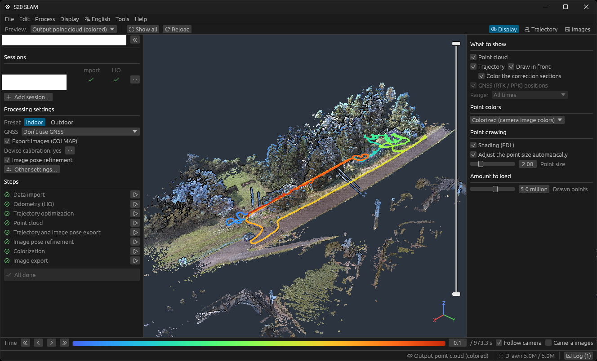

# s20-slam

[日本語](README_jp.md)

A post-processing app for the **SHARE SLAM S20**. From the S20's raw recording folder it computes the trajectory and makes a colored point cloud, without the vendor's software (PointClouds Studio). Windows, GUI and command line.



> An unofficial tool. It is not made, endorsed or supported by SHARE3DCAM.

## What it does

- **Trajectory**: LiDAR–inertial odometry, then a global optimization with the IMU, the planes of the point cloud and, outdoors, the device's RTK or PPK computed from `BASE.BIN` / `ROVER_PPKRAW.bin` (the positioning engine is built in).
- **Point cloud**: passers-by, cars, mirror images and haze removed, surfaces sharpened, then colored from the two fisheye cameras. Written as LAZ / LAS with a Potree 2.0 octree beside it.
- **Checking and fixing**: preview the scans and the output point cloud, color the trajectory by quality, and fix problem sections yourself (loops, sections without GNSS, sections with the heading held to the IMU).
- **Multiple sessions** of the same place joined into one trajectory and point cloud.
- **Images for 3D Gaussian Splatting**: the photos with refined poses as a COLMAP model.

## Download

Get the latest zip from [Releases](../../releases/latest), unzip it anywhere and run `s20-gui.exe`. No installer is needed.

The executables are not code-signed, so Windows may show "Windows protected your PC" the first time. Choose **More info → Run anyway**. They are built by GitHub Actions from the public source of this repository. To check the download, compare `Get-FileHash <zip>` in PowerShell with the `.sha256` file attached to the release.

The app keeps its settings, the device calibrations and crash logs in `%APPDATA%\S20 SLAM\data`. To move the device calibrations to another PC, copy that folder. To remove the app, delete the unzipped folder and that folder.

| File | |
|---|---|
| `s20-gui.exe` | The app |
| `s20.exe` | Command line (the same processing, for batches) |

### Requirements

- Windows 10 / 11, 64-bit
- A GPU with DirectX 12 (for the preview, and for parts of the processing)
- Memory: 16 GB or more is recommended. A long outdoor recording uses about 8 GB while the point cloud is made.
- Disk: besides the copy of the raw data, room for the results. For example, a 16-minute outdoor recording (11 GB of raw data) takes 3.5 GB up to the coloring, 8 GB with the image export. Nearly all of it is the point clouds and the photos; the intermediate files are under 100 MB.

Processing time, for example: the same 16-minute recording takes about 24 minutes up to the coloring (with an RTX 3060): odometry 2 min, trajectory optimization 1.5 min, point cloud 6 min, image pose refinement 7.5 min, coloring 6.5 min.

## Quick start

1. Copy the S20's recording folder (the one holding `all_*.bag`) to your PC as a whole. The app reads the points and images from the bag instead of copying them into the work folder, so leave the copy in place while you work on it.
2. Start `s20-gui.exe`, choose **New work folder…**, then pick the raw folder and an empty folder for the results.
3. In **Processing settings** on the left, choose the GNSS (none / the device's RTK / PPK). **Other settings…** has indoor / outdoor and the output format.
4. Press **Run from unfinished or unapplied steps**. The progress and the log are shown, and you can cancel at any time.
5. When it finishes, the results are in `<work folder>/output/`.

The language is chosen from the menu bar (English / 日本語). Until then it follows Windows' display language.

### Output

| File | |
|---|---|
| `pointcloud_colorized.laz` | The colored point cloud (with normals) |
| `pointcloud_uncolorized.laz` | The point cloud before coloring |
| `*_converted/` | Potree 2.0 octrees of the point clouds and the trajectory |
| `trajectory.txt`, `trajectory.las` | The trajectory (with GPS times) |
| `coordinate_frame.json` | When GNSS was used: the origin of the local coordinates |
| `images/`, `sparse/0/`, `masks/` | Optional: the photos with their poses, in PointClouds Studio's layout and as a COLMAP model |

With GNSS the coordinates are local, in meters around an origin near the site: X = east, Y = north, Z = up. Z is the height above the origin, not above sea level. The origin's latitude, longitude and ellipsoidal height are in `coordinate_frame.json`; keep it with the point cloud. Without GNSS each recording has its own coordinates: Z is up, X and Y have no fixed direction.

### Better colors: the device calibration

Once you have processed a few recordings of your device, **Tools → Device calibration** solves the cameras' mounting, fisheye and principal points again. The colors get fewer doubled edges and less blur than with the maker's factory calibration file (`calibration.yaml`).

- Choose some processed work folders. Include both outdoor recordings and indoor ones that see things up close (the last few mm of the mounting are only determined close up). Each recording takes 2-4 minutes.
- Once saved, it is used for every recording of the same device. Recordings already processed use it when redone from **Trajectory and image pose export**.

## Multiple sessions

To join recordings of the same place made in multiple sessions, add the other raw folders with **Add session…** in the left panel. They are optimized together as one trajectory and point cloud.

- **With RTK or PPK** (outdoors): the sessions are placed by GNSS. Nothing more is needed.
- **Without GNSS** (indoors and so on): the first session is the reference, and each other session needs to be connected to it once. In the right panel's **Trajectory**, add a **loop** at a place both sessions passed (click both trajectories there), or **point matches** on the same features. A session not connected yet shows **Not connected** in the session list. After that, places passed again are found automatically (revisits).

See [Multiple sessions](docs/gui.md#multiple-sessions) in the GUI guide for more.

## If the result is wrong

- **The trajectory drifts or the point cloud is doubled**: open **Trajectory** in the right panel, color it by a quality metric and look at the listed sections. Add a **loop** where you passed the same place twice (or **Start = end**), then **Apply the corrections**.
- **Bad GNSS in a section**: add it to **Sections without GNSS**.
- **The heading drifts on a round hill or a featureless slope**: add it to **Sections with heading held to the IMU**.
- **To look at the raw data**: **Tools → View raw data…** shows the bag's topics and messages and the GNSS observations.

See the [GUI guide](docs/gui.md) for more.

## Command line

```
s20 run <raw folder> <work folder> [--outdoor] [--ppk] [--no_rtk] [--no_color] [--las] [--images]
s20 run <raw 1>,<raw 2>,... <work folder> --outdoor      # multiple sessions of one place
s20 help                                                 # every command and option
```

## Feedback

s20-slam was made for my own use and has been tested on one S20 only (see [Known issues](docs/known-issues.md)), so support is best effort. Problems, questions and requests are welcome as [Issues](../../issues), though replies may take time. For a problem, please include the version (**Help → About**) and the log in the work folder's `logs/`.

## Documentation

- [GUI guide](docs/gui.md)
- [Command line](docs/cli.md)
- [How it works](docs/processing.md) (in Japanese)
- [PPK](docs/ppk.md) (in Japanese)
- [Validation](docs/validation.md)
- [Known issues](docs/known-issues.md)

## Building from source

Needs Rust (rustup installs the version in `rust-toolchain.toml`) and the MSVC C/C++ build tools (for RTKLIB).

```
cargo build --release
```

This builds `target/release/s20-gui.exe` and `target/release/s20.exe`.

## License

Apache License 2.0 ([LICENSE](LICENSE)). The third-party software included or ported (RTKLIB, small_gicp, Potree, PotreeConverter) is listed in [NOTICE](NOTICE), and the licenses of the crates and fonts in the executables are in [THIRD-PARTY-LICENSES.txt](THIRD-PARTY-LICENSES.txt). The app shows both under **Help → Licenses**, and so does `s20 licenses`.
