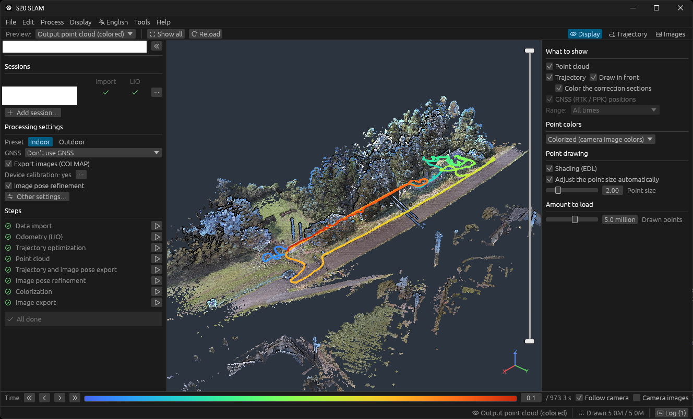

# s20-slam

[English](README.md)

**SHARE SLAM S20** の後処理アプリです。S20 の生データフォルダーから軌跡（自己位置・姿勢）を求め、着色した点群を作ります。メーカーソフト（PointClouds Studio）は使いません。Windows 用で、GUI とコマンドラインがあります。



> 非公式のツールです。SHARE3DCAM 社とは関係ありません。

## できること

- **軌跡**：LiDAR と IMU のオドメトリのあと、IMU・点群の面・GNSS（屋外。機体の RTK、または `BASE.BIN`／`ROVER_PPKRAW.bin` から計算する PPK。測位エンジンは内蔵）で全体を最適化します。
- **点群**：通行人や車の跡、鏡の虚像、もやを消し、面を締めてから、左右の魚眼カメラの画像で着色します。LAZ／LAS と、横に Potree 2.0 の 8 分木を出力します。
- **確認と修正**：スキャン点群と出力点群のプレビュー、品質による軌跡の色分け。問題のある区間は自分で直せます（ループ、GNSS を使わない区間、方位を IMU に任せる区間）。
- **複数セッション**：同じ場所を何回かに分けて撮ったデータを、1 つの軌跡と点群にまとめます。
- **3D Gaussian Splatting 用の画像**：姿勢を合わせた写真を COLMAP 形式で出力します。

## ダウンロード

[Releases](../../releases/latest) から最新の zip をダウンロードし、好きな場所に展開して `s20-gui.exe` を起動します。インストールは不要です。

exe にはコード署名がないため、初回の起動で「Windows によって PC が保護されました」と表示されることがあります。「詳細情報」→「実行」で起動できます。exe は GitHub Actions で、このリポジトリの公開されたソースからビルドしています。ダウンロードした zip は、PowerShell の `Get-FileHash <zip>` の値を Release に添付した `.sha256` ファイルと見比べて確かめられます。

アプリの設定、機体の校正、クラッシュ時のログは `%APPDATA%\S20 SLAM\data` に保存します。機体の校正を別の PC に移すときは、このフォルダーをコピーしてください。アプリを削除するときは、展開したフォルダーとこのフォルダーを消してください。

| ファイル | |
|---|---|
| `s20-gui.exe` | アプリ本体 |
| `s20.exe` | コマンドライン（同じ処理。まとめて処理するとき） |

### 動作環境

- Windows 10／11（64 ビット）
- DirectX 12 対応の GPU（プレビューと、処理の一部に使います）
- メモリ：16 GB 以上を推奨。長い屋外の撮影では、点群生成で約 8 GB 使います。
- ディスク：生データのコピーのほかに、成果物の分が要ります。例：屋外の 16 分の撮影（生データ 11 GB）で、着色まで 3.5 GB、画像の出力も行うと 8 GB。ほとんどが点群と画像で、途中結果は 100 MB 以下です。

処理時間の目安：同じ 16 分の撮影で、着色まで約 24 分（GPU は RTX 3060）。内訳は LIO 2 分、軌跡の最適化 1.5 分、点群生成 6 分、画像の姿勢合わせ 7.5 分、着色 6.5 分です。

## 使い方

1. S20 の撮影フォルダー（`all_*.bag` のあるフォルダー）を、丸ごと PC にコピーします。点と画像は作業フォルダーに複製せず bag から直接読むので、コピーしたフォルダーは処理が終わるまで同じ場所に置いておいてください。
2. `s20-gui.exe` を起動して「新規作業フォルダー…」を押し、生データフォルダーと、結果を置く空のフォルダーを選びます。
3. 左パネルの「処理設定」で GNSS（使わない／機体の RTK／PPK）を選びます。屋内／屋外や出力形式は「その他の設定…」にあります。
4. 「未完了・未反映の工程から実行」を押します。進捗とログが表示され、途中で中断もできます。
5. 終わると、`<作業フォルダー>/output/` に成果物ができます。

表示言語はメニューバー（English／日本語）で切り替えます。選ぶまでは Windows の表示言語に合わせます。

### 成果物

| ファイル | |
|---|---|
| `pointcloud_colorized.laz` | 着色済みの点群（法線つき） |
| `pointcloud_uncolorized.laz` | 着色前の点群 |
| `*_converted/` | 点群と軌跡の Potree 2.0 の 8 分木 |
| `trajectory.txt`、`trajectory.las` | 軌跡（GPS 時刻つき） |
| `coordinate_frame.json` | GNSS を使ったとき：ローカル座標の原点 |
| `images/`、`sparse/0/`、`masks/` | オプション：姿勢つきの写真（PointClouds Studio と同じ形式、COLMAP 形式） |

GNSS を使うと、座標は現場付近を原点に、X＝東、Y＝北、Z＝上（単位 m）になります。Z は原点からの高さで、標高ではありません。原点の緯度・経度・楕円体高は `coordinate_frame.json` にあるので、点群と一緒に保管してください。GNSS を使わないときは撮影ごとの座標で、Z は上向きですが、X・Y の向きは決まっていません。

### 着色の品質を上げる（機体の校正）

同じ機体の撮影をいくつか処理したら、「ツール」→「機体の校正」で、カメラの取り付け・魚眼・主点を求め直せます。メーカーの校正ファイル（出荷時の `calibration.yaml`）のままより、着色の二重化やぼけが減ります。

- 処理済みの作業フォルダーを数本選びます。屋外の撮影と、近くを写す屋内の撮影を両方含めてください（取り付け位置の数 mm は、近くを写す撮影でしか決まりません）。1 撮影あたり 2〜4 分かかります。
- 一度保存すると、同じ機体の撮影には自動で使われます。すでに処理した撮影は、「軌跡・画像姿勢の出力」からやり直すと反映されます。

## うまくいかないとき

- **軌跡がずれる・点群が二重になる**：右パネルの「軌跡」で品質の指標で色分けし、一覧に出る区間を確認します。同じ場所を 2 回通ったところに「ループ」（または「始点＝終点」）を追加して、「修正を反映する」を押します。
- **GNSS がおかしい区間がある**：その区間を「GNSS を使わない区間」に追加します。
- **丸い丘や特徴のない斜面で方位がずれる**：その区間を「方位を IMU に任せる区間」に追加します。
- **生データを確かめたい**：「ツール」→「生データを見る…」で、bag のトピック・メッセージや GNSS の観測を確認できます。

詳しくは [GUI の使い方](docs/gui_jp.md) を参照してください。

## コマンドライン

```
s20 run <生データフォルダー> <作業フォルダー> [--outdoor] [--ppk] [--no_rtk] [--no_color] [--las] [--images]
s20 run <生データ1>,<生データ2>,... <作業フォルダー> --outdoor   # 同じ場所の複数セッション
s20 help                                                        # すべてのコマンドとオプション
```

## 不具合の報告・要望

動作を確かめたのは作者の S20 1 台だけです（[既知の課題](docs/known-issues_jp.md)）。不具合、質問、要望は [Issues](../../issues) にお寄せください。不具合の報告には、バージョン（「ヘルプ」→「このアプリについて」）と、作業フォルダーの `logs/` にあるログを添えてください。

## ドキュメント

- [GUI の使い方](docs/gui_jp.md)
- [コマンドライン](docs/cli_jp.md)
- [処理の仕組み](docs/processing.md)
- [PPK](docs/ppk.md)
- [検証結果](docs/validation_jp.md)
- [既知の課題](docs/known-issues_jp.md)

## ソースからのビルド

Rust（`rust-toolchain.toml` の版を rustup が自動で入れます）と、RTKLIB のビルドに使う MSVC の C/C++ ビルドツールが必要です。

```
cargo build --release
```

`target/release/s20-gui.exe` と `target/release/s20.exe` ができます。

## ライセンス

Apache License 2.0（[LICENSE](LICENSE)）。同梱・移植しているもの（RTKLIB、small_gicp、Potree、PotreeConverter）の出典とライセンスは [NOTICE](NOTICE)、exe に組み込まれる依存クレートとフォントのライセンスは [THIRD-PARTY-LICENSES.txt](THIRD-PARTY-LICENSES.txt) にあります。どちらもアプリの「ヘルプ」→「ライセンス」と `s20 licenses` で表示できます。
